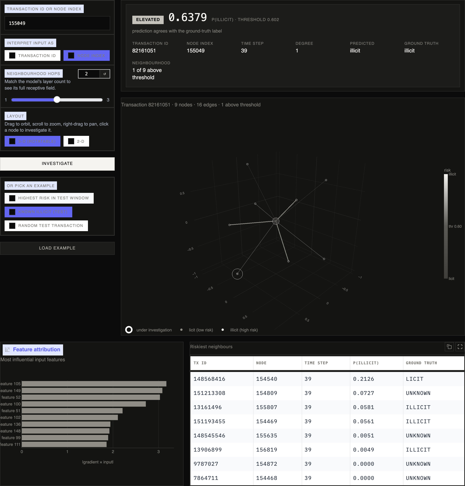
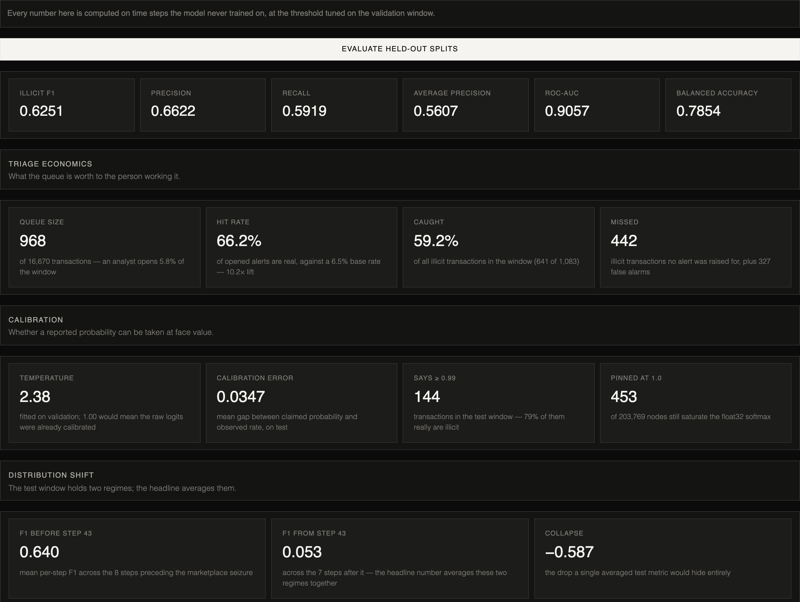
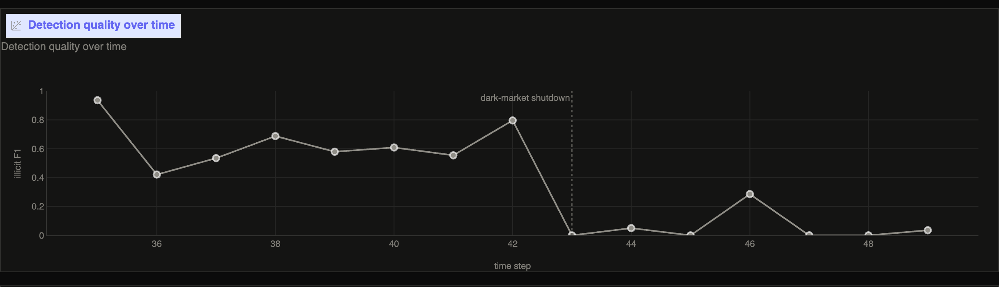
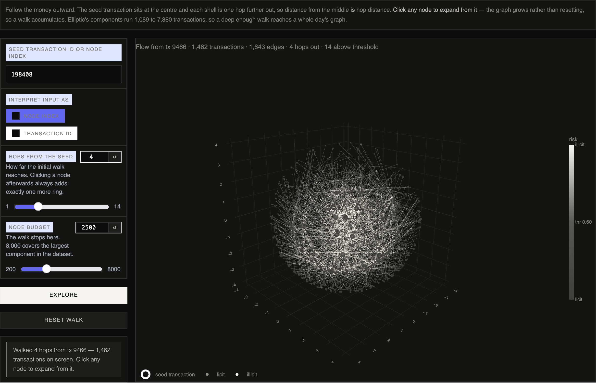

# Bitcoin AML with graph neural networks

We built an anti-money-laundering pipeline for the [Elliptic dataset](https://www.kaggle.com/datasets/ellipticco/elliptic-data-set), a graph of 203,769 Bitcoin transactions of which 4,545 are labelled illicit. It trains graph neural networks and a random-forest baseline on a strict temporal split, explains every score, and serves the results through an investigation UI with 3-D neighbourhood views.

Stack: PyTorch, PyTorch Geometric, scikit-learn, Gradio, Plotly. Python 3.10 or newer.





## Quickstart

About 800 MB of disk for the dataset, which downloads on the first training run. No API keys or environment variables.

```bash
python3.12 -m venv .venv && source .venv/bin/activate
pip install -e .[dev]

python scripts/launch_ui.py                        # serves the committed checkpoints at http://127.0.0.1:7860
python scripts/train.py --config configs/gat.yaml  # retrains the default model (about 18 min on an M-series GPU)
python scripts/train_rf.py                         # random-forest baseline, under a minute
pytest                                             # 96 tests
```

The full benchmark below is reproduced by `scripts/run_benchmark.sh` (three seeds, five models, two feature sets, roughly four hours) followed by `python scripts/summarise_runs.py --dir artifacts/benchmark`. Trained checkpoints and every run's metrics are committed under `artifacts/`, so the UI and the tables work without training anything.

## What we found

All numbers are illicit-class scores on the held-out test window (time steps 35 to 49, 16,670 labelled transactions) at a threshold tuned on the validation window. Mean ± standard deviation over seeds 0, 1 and 2. "All" uses the 165 Elliptic features; "local" drops the 72 that are already hand-built neighbourhood aggregates, leaving the 93 that describe the transaction alone.

| Model | Features | Train time | Precision | Recall | F1 | Avg precision | ROC AUC |
|---|---|---|---|---|---|---|---|
| Random forest | all | 7 s | 0.919 ± 0.054 | 0.723 ± 0.004 | **0.809 ± 0.019** | 0.784 ± 0.002 | 0.919 ± 0.003 |
| GCN | all | 11 min | 0.537 ± 0.030 | 0.566 ± 0.032 | 0.550 ± 0.019 | 0.456 ± 0.032 | 0.888 ± 0.004 |
| GAT (GATv2) | all | 48 min | 0.568 ± 0.050 | 0.530 ± 0.068 | 0.547 ± 0.053 | 0.481 ± 0.071 | 0.889 ± 0.005 |
| GraphSAGE | all | 5 min | 0.500 ± 0.018 | 0.599 ± 0.026 | 0.545 ± 0.021 | 0.470 ± 0.045 | 0.873 ± 0.005 |
| MLP (no graph) | all | 1 min | 0.364 ± 0.021 | 0.659 ± 0.042 | 0.468 ± 0.019 | 0.294 ± 0.046 | 0.857 ± 0.013 |
| Random forest | local | 4 s | 0.860 ± 0.071 | 0.713 ± 0.009 | **0.778 ± 0.025** | 0.776 ± 0.002 | 0.891 ± 0.005 |
| GAT (GATv2) | local | 49 min | 0.379 ± 0.016 | 0.726 ± 0.002 | 0.498 ± 0.013 | 0.419 ± 0.034 | 0.882 ± 0.007 |
| GraphSAGE | local | 7 min | 0.365 ± 0.026 | 0.717 ± 0.011 | 0.484 ± 0.021 | 0.358 ± 0.009 | 0.872 ± 0.002 |
| GCN | local | 5 min | 0.348 ± 0.006 | 0.711 ± 0.004 | 0.467 ± 0.005 | 0.307 ± 0.020 | 0.864 ± 0.004 |
| MLP (no graph) | local | 1 min | 0.336 ± 0.059 | 0.722 ± 0.017 | 0.456 ± 0.049 | 0.266 ± 0.027 | 0.857 ± 0.007 |

Training times are per run on an Apple M-series GPU with two runs sharing it, so they are upper bounds.

**A random forest beats every graph model, by a lot.** This reproduces the finding in Weber et al. (2019), the paper that introduced the dataset, and we think it is the most useful result here. The GNNs add message passing on top of features that already summarise the neighbourhood, and on this data that extra structure buys less than a well-regularised ensemble of trees. We started this project expecting the opposite.

**Message passing is worth a few points, not a few tenths.** With all features, the three graph models land within 0.005 F1 of each other and about 0.08 above the no-graph MLP. Strip out the aggregate features and that gap shrinks to between 0.01 and 0.04, which is the size of the seed-to-seed spread. Attention does not earn its cost either: the GAT takes four to ten times longer to train than GCN or GraphSAGE for the same mean F1 and the widest variance of the three. Our earlier single-seed run of the GAT (seed 42, the checkpoint the UI serves) scored 0.625 F1, which sits well above the three-seed mean and would have overstated the case for attention had we stopped there.

**The temporal split is what makes these numbers mean anything.** Every edge in Elliptic joins two transactions from the same time step, so the graph is really 49 disconnected islands. A random split puts near-identical neighbours on both sides and inflates every score. We train on steps 1 to 30, tune on 31 to 34 and report on 35 to 49, and nodes outside the training window are masked rather than removed so message passing still sees the full graph.

| Split | Time steps | Labelled nodes | Illicit | Illicit share |
|---|---|---|---|---|
| Train | 1 to 30 | 26,905 | 2,954 | 11.0% |
| Validation | 31 to 34 | 2,989 | 508 | 17.0% |
| Test | 35 to 49 | 16,670 | 1,083 | 6.5% |

### Everything collapses after step 43



The dominant illicit marketplace in the data was shut down around time step 43. The illicit transactions that remain afterwards look nothing like the ones any model trained on. Per-step F1 of the served checkpoints, pooled over two regimes:

| Steps | Labelled | Illicit | Illicit share | GAT F1 | GraphSAGE F1 | GCN F1 | MLP F1 |
|---|---|---|---|---|---|---|---|
| 35 to 42 | 9,983 | 914 | 9.2% | 0.707 | 0.606 | 0.569 | 0.432 |
| 43 to 49 | 6,687 | 169 | 2.5% | 0.024 | 0.022 | 0.005 | 0.009 |

The benchmark runs all agree. Averaging per-step F1 over the three seeds, no model in any configuration scores above 0.07 after step 43, the random forest included, while every one of them sits between 0.55 and 0.89 before it.

Every headline number above averages a regime where the models work and one where they do not work at all. The models learned the signature of one criminal operation and lost it when that operation disappeared. The performance tab plots the drop instead of smoothing it away.

### Does retraining on fresher labels fix it?

We tested the obvious remedy by moving the training window forward and scoring only the post-shutdown steps. Illicit F1 pooled over the scored steps, mean of three seeds, same threshold protocol as above:

| Training window | Scored on | Random forest | MLP | GCN | GraphSAGE |
|---|---|---|---|---|---|
| Steps 1 to 30 (benchmark models) | 43 to 49 | 0.029 | 0.015 | 0.007 | 0.019 |
| Steps 1 to 38 | 43 to 49 | 0.032 | 0.035 | 0.019 | 0.026 |
| Steps 1 to 30 (benchmark models) | 45 to 49 | 0.029 | 0.026 | 0.013 | 0.020 |
| Steps 1 to 43 | 45 to 49 | 0.104 | 0.150 | 0.171 | 0.071 |

More pre-shutdown data does nothing: training through step 38 instead of 30 leaves every model below 0.04. Two post-shutdown steps of labels help, but only to between 0.07 and 0.17 F1 against 0.55 to 0.89 before the shutdown, and on a window with just 121 illicit transactions among 3,726 labelled ones. The neural models recover more than the random forest here, which reverses the main benchmark, though three seeds on 121 positives is thin evidence for that. The practical reading is that a deployment cannot wait for drift to show up in the metrics and retrain its way out; the post-shutdown illicit activity is a different population and needs its own labels in volume. `scripts/run_drift.sh` reproduces this table.

### What this buys an investigator

At a 6.5% base rate an analyst picking transactions at random opens about fifteen dead ends per real case. The served GAT turns the test window into a queue of 968 alerts of which 641 are illicit: a 66% hit rate, tenfold over the base rate, catching 59% of all illicit activity while reviewing under 6% of transactions. The random forest does better still. The threshold slider in the UI moves that trade-off live.

## How it works

Four stages, one module each under `src/aml_gnn`.

**Data.** The PyTorch Geometric loader discards transaction ids and time steps. We read them back from the raw CSV, verify that the feature and label files are row-aligned, build the three temporal masks, standardise features with training-window statistics only, and make the edge list undirected.

**Models.** GATv2, GraphSAGE, GCN and an MLP control share one template: a stack of `conv, norm, ReLU, dropout` blocks with residual connections, jumping knowledge over all layers, and a small classification head. The MLP has the same depth and width and ignores the edges, so the difference between it and any graph model is the contribution of message passing and nothing else. The random forest is 200 scikit-learn trees on the same splits.

**Training.** The whole graph fits in memory (about 135 MB), so training is full-batch with no neighbour sampling. Class-weighted cross-entropy, early stopping on validation illicit F1, learning-rate drop on plateau, gradient clipping. The decision threshold is tuned on validation rather than fixed at 0.5, because the operating point in AML is a choice about how many false alarms a team can absorb.

**Calibration.** Cross-entropy kept pushing logits apart long after the classes separated, to the point that float32 softmax reported exactly 1.0 on transactions the model got wrong. We fit a single temperature on validation and divide the logits by it before the softmax. Rankings and therefore F1, AUC and AP are unchanged, but the probabilities shown to an analyst now mean what they say: expected calibration error on the test window fell to 0.035 for the GAT.

**Serving.** One `InferenceService` loads a checkpoint, scores the graph once, and answers the UI's questions: rank a window, extract and explain a k-hop neighbourhood, walk the payment graph outward from a seed. Explanations come from GAT attention weights as edge importance and an input-gradient saliency map over the centre node's features.



The Gradio app has five tabs: a case view, a ranked alert queue, the model performance page, the flow explorer above, and an atlas of the learned embedding across all 49 time steps.

## Limitations

- Three seeds is enough to see that the spread is large, not enough to put tight intervals on it. No hyperparameter search was done for any model.
- The GNNs are transductive. Scoring a new transaction means re-running the whole graph, about a second rather than milliseconds.
- The 165 features are anonymised, so feature attribution can name a dimension but not say what it measures.
- The post-step-43 collapse is measured, and the retraining experiment shows it is not fixed by fresher labels alone. We did not try drift detection or domain adaptation.
- Validation is four time steps with a 17% illicit rate, well above train or test. Thresholds and temperatures tuned on it carry that skew.
- The served GAT checkpoint is a single seed-42 run that landed above the multi-seed mean. It is kept because its attention weights power the explanations, not because it is representative.
